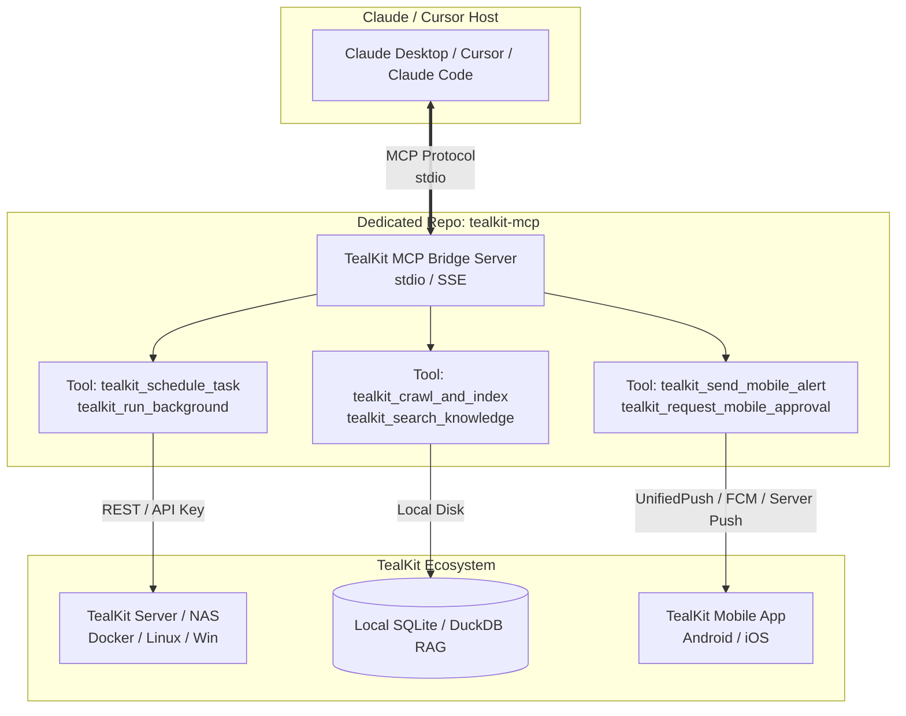
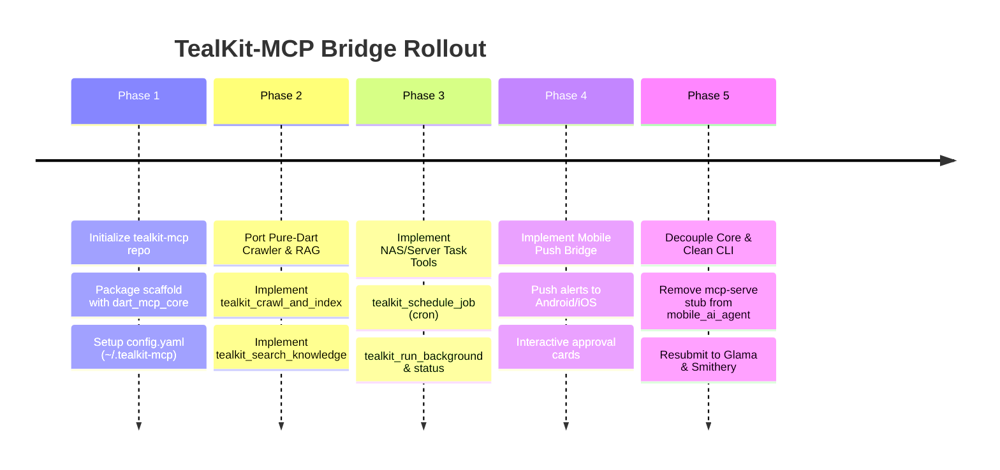

# Architecture & Implementation Plan: `tealkit-mcp` Bridge Server

A dedicated, lightweight Model Context Protocol (MCP) server that empowers **Claude Desktop, Cursor, Claude Code, and Windsurf** with capabilities they inherently lack:
1. **Persistent Background & Cron Tasks on NAS/Server** (Fire-and-forget, scheduled jobs)
2. **Deep Recursive Web-Crawling & Document RAG** (Pure-Dart offline indexer with zero Python dependencies)
3. **Mobile Push Alerts & Human-in-the-Loop Approvals** (Instant push notifications and interactive approvals on the TealKit Android/iOS app)

---

## 1. Architectural Strategy: New Repo vs. Monorepo

> [!IMPORTANT]
> **Recommendation: Create a new dedicated repository (`tealkit-mcp`) in a new project folder.**

### Why a Separated Repository is the Cleanest Choice:
- **Glama & Smithery Reviewers**: Glama, Smithery, and Cursor MCP Directory require a repository whose root `README.md` explicitly documents an MCP server (`stdio` / `SSE`), its exposed tool schemas, and connection snippets. A separate repo guarantees **instant approval without confusion**.
- **Lightweight Distribution**: External Claude/Cursor users shouldn't clone or download a 200MB Flutter client app. `tealkit-mcp` will be a featherweight Dart package (~15MB binary or runnable via `dart run`).
- **Core Decoupling**: Removing the legacy `mcp-serve` stub from `mobile_ai_agent/cli` keeps the TealKit core app 100% focused on being a premier autonomous AI agent workstation and mobile app.



---

## 2. The 3 Core Pillars & Exposed MCP Tools

### Pillar 1: Persistent Background Tasks & NAS/Server Automation
Claude is strictly synchronous: once your prompt finishes or you close the chat, execution ends. TealKit Server runs 24/7 on your NAS, local home lab, or VPS.

| MCP Tool Name | Description | Key Parameters |
| :--- | :--- | :--- |
| `tealkit_schedule_job` | Schedules a recurring cron task on the TealKit Server | `cron` (e.g. `'0 3 * * *'`), `task_name`, `prompt_or_command`, `profile` |
| `tealkit_run_background` | Dispatches an asynchronous long-running task to the server | `task_id` or `command`, `timeout_minutes`, `notify_on_complete` |
| `tealkit_get_job_status` | Inspects execution logs and exit status of a background job | `job_id`, `tail_lines` |
| `tealkit_list_jobs` | Lists active, scheduled, and past jobs on the server | `status` (`running`, `scheduled`, `failed`, `all`) |

---

### Pillar 2: Deep Web-Crawler & Document Knowledge Base (RAG)
Generic MCP fetch tools only download a single webpage. TealKit's built-in pure-Dart crawler can recursively traverse documentation trees, parse PDFs/Word documents, and build a local vector & BM25 hybrid index.

| MCP Tool Name | Description | Key Parameters |
| :--- | :--- | :--- |
| `tealkit_crawl_and_index` | Recursively crawls a website (up to `max_pages`) and indexes all content | `root_url`, `max_pages` (default 50), `allowed_path_prefix`, `reindex` |
| `tealkit_index_local_docs` | Ingests and chunks local folders (PDF, DOCX, TXT, MD, CSV) | `folder_path`, `extensions`, `chunk_size` |
| `tealkit_search_knowledge` | Performs hybrid (BM25 + Nomic Vector) search with exact line numbers and citations | `query`, `max_chunks` (default 5), `min_score` |
| `tealkit_get_source_doc` | Retrieves the original full document or section referenced in a search | `document_id` or `url` |

---

### Pillar 3: Mobile Bridge & Interactive Human-in-the-Loop Approvals
Claude Code / Cursor runs on your workstation. When a deployment fails or a 45-minute build completes, you might be away from your desk.

| MCP Tool Name | Description | Key Parameters |
| :--- | :--- | :--- |
| `tealkit_send_mobile_alert` | Pushes an instant high-priority notification to the TealKit Android/iOS app | `title`, `message`, `priority` (`low`, `normal`, `high`, `urgent`), `category` |
| `tealkit_request_mobile_approval` | Sends an interactive approval card to your phone and blocks until you tap **Approve** or **Reject** | `title`, `summary`, `diff_or_details`, `timeout_seconds` (e.g. 300), `options` |
| `tealkit_get_mobile_status` | Checks if the user's mobile device is online and reachable | `device_name` or `default` |

---

## 3. Project Structure: `tealkit-mcp`

The new project will be located at:
`c:\projects\ls\tealkit-mcp` (or GitHub: `github.com/lschaffer/tealkit-mcp`)

```
tealkit-mcp/
├── .github/
│   └── workflows/
│       └── release.yml              # Automated cross-platform binary builds (Win/macOS/Linux)
├── bin/
│   └── tealkit_mcp.dart             # Main stdio / SSE entry point
├── lib/
│   ├── src/
│   │   ├── bridge/
│   │   │   ├── server_client.dart   # REST client to TealKit Server / NAS
│   │   │   ├── push_service.dart    # Mobile Push / Approval gateway
│   │   │   └── config_manager.dart  # ~/.tealkit-mcp/config.yaml
│   │   ├── rag/
│   │   │   ├── crawler.dart         # Multi-page recursive crawler (migrated from TealKit CLI)
│   │   │   ├── extractors/          # PDF, DOCX, Text extractors
│   │   │   └── database.dart        # SQLite FTS5 + Hybrid vector search
│   │   ├── tools/
│   │   │   ├── task_tools.dart      # Background & Cron job handlers
│   │   │   ├── rag_tools.dart       # Crawl & Search handlers
│   │   │   └── mobile_tools.dart    # Push & Approval handlers
│   │   └── server/
│   │       ├── mcp_stdio_server.dart
│   │       └── mcp_sse_server.dart
│   └── tealkit_mcp.dart
├── test/
├── .env.example
├── pubspec.yaml
├── smithery.yaml                    # Smithery MCP registry config
└── README.md                        # Glama & Cursor optimized documentation
```

---

## 4. Decoupling from TealKit Core (`mobile_ai_agent`)

To maintain clean architecture:
1. **Remove from Core**:
   - Deprecate `mcp serve` and `mcp-serve` from `cli/lib/src/commands/mcp_command.dart`.
   - Remove unused stub SSE/stdio MCP server classes from `cli/lib/src/mcp/`.
2. **Keep in Core**:
   - Keep TealKit's **MCP Client** capabilities (`MultiMcpManager`, `dart_mcp_core`) so the TealKit Desktop and Mobile apps can continue connecting to external MCP servers and tools!
   - Keep the standalone `/rag` and `/code` agents in `tealkit.exe`.
3. **Linkage**:
   - `tealkit-mcp` connects to TealKit Server via `tealkit_api` (HTTP/REST) or reads the local TealKit SQLite database when operating on the same machine.

---

## 5. Step-by-Step Implementation Roadmap



### Phase 1: Repo Creation & Foundation
- Create local directory: `c:\projects\ls\tealkit-mcp`.
- Initialize `pubspec.yaml` with `dart_mcp_core`, `http`, `sqlite3`, `path`.
- Configure `bin/tealkit_mcp.dart` as a robust stdio JSON-RPC server.

### Phase 2: Web-Crawler & RAG Integration
- Port the pure-Dart web crawler, PDF extractor, DOCX extractor, and SQLite database from `cli/lib/src/rag/` into `tealkit-mcp`.
- Expose `tealkit_crawl_and_index` and `tealkit_search_knowledge`.

### Phase 3: NAS / Server Background Automation
- Connect to TealKit Server's task management endpoints (`/api/tasks`, `/api/tasks/run`).
- Expose `tealkit_schedule_job`, `tealkit_run_background`, and `tealkit_get_job_status`.

### Phase 4: Mobile Push & Approval Gateway
- Leverage TealKit Server's device push messaging (FCM / UnifiedPush / local SSE stream).
- Implement `tealkit_send_mobile_alert` and `tealkit_request_mobile_approval`.

### Phase 5: Clean Core Repo & Submit to Glama
- Strip the legacy `mcp-serve` stub from `mobile_ai_agent/cli`.
- Publish `github.com/lschaffer/tealkit-mcp` with clean README, tool schemas, and one-click Claude Desktop config.
- Resubmit to Glama and Smithery.
